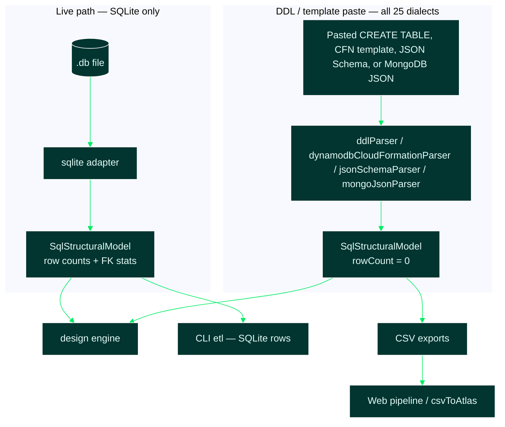

# 18 — Supported SQL Dialects & DDL Import

Sources: [`src/dialects.ts`](../src/dialects.ts),
[`src/utilities/ddlParser.ts`](../src/utilities/ddlParser.ts),
[`src/adapters/sqlite.ts`](../src/adapters/sqlite.ts),
[`src/server/index.ts`](../src/server/index.ts)

## 1. High-Level Summary

hvyMETL supports **twenty-five schema import dialects** (twenty-two SQL DDL dialects plus
**Amazon DynamoDB CloudFormation**, **JSON Schema**, and **MongoDB JSON**). They fall into two capability tiers:

1. **Live database** — **SQLite only** (`better-sqlite3` adapter): real row counts,
   FK cardinality, range splits, and direct CLI ETL from the `.db` file.
2. **DDL / template paste** — **all twenty-five dialects**: paste `CREATE TABLE` scripts,
   DynamoDB CloudFormation templates, JSON Schema bundles, or MongoDB JSON / NDJSON; parsers build the same
   `SqlStructuralModel` the design engine consumes. Row counts default to zero; relationship
   stats use conservative defaults.

For the **web Full Pipeline**, SQL dialects take **CSV exports** (one file per table) and load them with csvToAtlas. JSON Schema and DynamoDB take the same CSV exports, shape them, write NDJSON, and load with [`mongoimport`](https://www.mongodb.com/try/download/database-tools). MongoDB JSON loads the pasted or uploaded documents with `mongoimport`. Set `MONGOIMPORT_PATH`, or put the binary on `PATH`. The CLI `etl` command is unchanged and still reads rows from SQLite only.

Oracle sample DDL and CSVs ship under [`examples/oracle/`](../examples/oracle/).

## 2. Dialect Matrix

Definitions: [`src/dialects.ts`](../src/dialects.ts) · UI/API: `GET /api/dialects`

| Dialect ID | Label | Schema import | Live adapter | Parser / notes |
| --- | --- | --- | --- | --- |
| `sqlite` | SQLite | File upload, DDL paste, or Rust agent | **Yes** | Studio file upload or agent (`sqlite://` / path) |
| `postgresql` | PostgreSQL | URI, DDL paste, or Rust agent | Yes | Live `information_schema`, agent WSS extract, or `CREATE TABLE` |
| `mysql` | MySQL | URI, DDL paste, or Rust agent | Yes | Live `information_schema`, agent WSS extract, or backtick identifiers |
| `mariadb` | MariaDB | DDL paste or Rust agent (MySQL URI) | Yes | MySQL wire via agent; `AUTO_INCREMENT`, inline FKs |
| `mssql` | Microsoft SQL Server | DDL paste or Rust agent | Yes | Agent `mssql://` / `sqlserver://`; T-SQL DDL paste |
| `sybase` | SAP ASE (Sybase) | DDL paste | No | T-SQL-like DDL; `IDENTITY` columns, `dbo.` prefixes, `database..table` shorthand |
| `clickhouse` | ClickHouse | DDL paste | No | Column-oriented DDL subset |
| `oracle` | Oracle | DDL paste | No | `VARCHAR2`, `NUMBER`, identity columns, `CONSTRAINT … FOREIGN KEY` (Wave B agent later) |
| `db2` | IBM Db2 | DDL paste | No | Schema-qualified names (`"SALES"."ORDERS"`) |
| `cockroachdb` | CockroachDB | DDL paste or Rust agent (postgres URI) | Yes | PostgreSQL wire via agent |
| `yugabyte` | YugabyteDB | DDL paste or Rust agent (postgres URI) | Yes | PostgreSQL wire via agent |
| `aurora-postgresql` | Amazon Aurora (PostgreSQL) | DDL paste or Rust agent | Yes | PostgreSQL wire via agent |
| `aurora-mysql` | Amazon Aurora (MySQL) | DDL paste or Rust agent | Yes | MySQL wire via agent |
| `redshift` | Amazon Redshift | DDL paste or Rust agent (postgres URI) | Yes | PostgreSQL-compatible wire via agent |
| `snowflake` | Snowflake | DDL paste | No | `AUTOINCREMENT`, `VARIANT`, `NUMBER`, inline FKs |
| `bigquery` | Google BigQuery | DDL paste | No | Backtick-qualified names, trailing `PRIMARY KEY`, `INT64` / `STRING` |
| `spanner` | Google Cloud Spanner | DDL paste | No | Trailing `PRIMARY KEY (…)`, `INT64` / `STRING` / `BYTES` |
| `databricks` | Databricks SQL / Spark SQL | DDL paste | No | `USING DELTA`, table-level FK constraints |
| `dynamodb` | Amazon DynamoDB (CloudFormation) | Template paste (YAML/JSON) | No | `AWS::DynamoDB::Table` — keys, GSIs, TTL attributes. GSI → MongoDB mapping: [docs/20-dynamodb-gsi-mongodb-migration.md](./20-dynamodb-gsi-mongodb-migration.md) |
| `json-schema` | JSON Schema | JSON paste | No | Draft 2020-12. `$ref` between schemas is an FK. A CMS export (root arrays of `$ref`s into `$defs` or `definitions`) is one table per array, named by the property, with nested objects left nested ([doc](19-json-schema-import.md)) |
| `mongodb-json` | MongoDB JSON | JSON / NDJSON paste | No | Extended JSON documents. One document is one table. An object of document arrays is one table per array. Nested objects stay nested. Pipeline load uses `mongoimport`, not csvToAtlas |
| `singlestore` | SingleStore (MemSQL) | DDL paste | No | MySQL-compatible; `AUTO_INCREMENT` |
| `sap-hana` | SAP HANA | DDL paste | No | `NVARCHAR`, `GENERATED BY DEFAULT AS IDENTITY`, table-level FKs |
| `teradata` | Teradata | DDL paste | No | `CREATE MULTISET TABLE`, table-level PK/FK |
| `firebird` | Firebird | DDL paste | No | Inline `REFERENCES`, integer PKs |

The dialect selector in Migration Studio sets the model `source` label (e.g.
`ddl:snowflake`) and documents which SQL syntax to paste; parsing is shared with
dialect-specific handling for qualified names, quoted FK targets, Spanner-style
primary keys, Teradata `MULTISET TABLE`, and warehouse-specific column types.



## 3. Technical Details

### `DIALECTS`, validation, and `isLiveSourceDialect(dialectId)`

| Export | Description |
| --- | --- |
| `DIALECTS` | Array of `{ id, label, live, parserFamily }` — `live: true` only for SQLite |
| `SUPPORTED_DIALECT_IDS` | Canonical id list used by tests and API validation |
| `normalizeDialectId(id)` | Lowercases and resolves aliases (`spark-sql` → `databricks`, `memsql` → `singlestore`) |
| `isSupportedDialect(id)` | `true` when the id (or alias) is registered |
| `resolveImportDialect(id)` | Returns canonical id; throws on unknown ids; defaults to `postgresql` when omitted |
| `getDialectLabel(id)` | Display name for UI and pipeline hints |
| `getDialectParserFamily(id)` | Parser compatibility family (`postgresql`, `mysql`, `snowflake`, …) |
| `isLiveSourceDialect(id)` | `true` only when a database file can be uploaded |
| `inferSchemaDialect(model, sessionDialect)` | Resolves dialect from `model.source` (`ddl:…`, `example:…`) then UI session |
| `getCsvSourceHint(dialect)` | User-facing CSV export instructions per dialect |

`POST /api/schema/import-ddl` validates the requested dialect with
`resolveImportDialect` and returns `400` when the id is not supported.

### `parseSchemaImport(content, dialect, sourceLabel): SqlStructuralModel`

[`src/utilities/schemaImport.ts`](../src/utilities/schemaImport.ts) routes imports by dialect.
SQL dialects use [`parseDdlToModel`](../src/utilities/ddlParser.ts). DynamoDB uses
[`parseDynamoDbCloudFormationToModel`](../src/utilities/dynamodbCloudFormationParser.ts) for
YAML or JSON CloudFormation templates containing `AWS::DynamoDB::Table` resources. JSON Schema
uses [`parseJsonSchemaToModel`](../src/utilities/jsonSchemaParser.ts) — see
[19-json-schema-import.md](19-json-schema-import.md). A document whose root `properties` are all
arrays of `#/$defs/…` or `#/definitions/…` refs is one table per array (`authors`, `categories`,
`mediaAssets`, `posts`). Nested objects such as `dimensions` and `meta` stay columns. That paste
still imports as JSON Schema when the studio dialect is already MongoDB JSON. A Mongo document
that only has a `properties` field does not.

Pasted **JSON** is also auto-detected when it is a **`SqlStructuralModel`** (`{ "source", "tables", "relationships" }`)
or a **Migration Studio diagram export** (`{ "version", "dialect", "ddl", "model" }` — see
`examples/*/hvymetl-diagram-*.json`). The API accepts `ddl` as a string or a JSON object; the response
includes synthesized or bundled SQL in `ddl` for the editor.

### `parseDdlToModel(ddl, sourceLabel): SqlStructuralModel`

[`src/utilities/ddlParser.ts`](../src/utilities/ddlParser.ts) — lightweight parser for
instant schema import. Extracts:

- Table names (including schema-qualified and quoted identifiers)
- Columns and SQL types → BSON type hints via `sqlTypeToBsonType`
- Primary keys (inline, table-level, and Spanner trailing `PRIMARY KEY (…)`)
- Foreign keys (inline `REFERENCES` and `CONSTRAINT … FOREIGN KEY`)

Does **not** execute DDL, connect to a server, or infer live statistics.

### Live SQLite adapter

[`createSqliteAdapter(path)`](../src/adapters/sqlite.ts) implements `SqlSourceAdapter`:
`introspect`, `dumpDdl`, `getKeyRange`, `iterate`, `close`. Used by CLI `design`,
`etl`, and `prompt` commands. See [04-adapters.md](04-adapters.md).

## 4. Edge Cases & Limitations

- **DDL-only dialects:** `rowCount` is `0` on every table; embed vs reference decisions
  lean on structure and workload profile, not measured cardinality.
- **Spanner `INTERLEAVE IN PARENT`:** not modeled as automatic parent-child embeds;
  interleaved tables appear as separate ER nodes (FK-like edges when declared).
- **Parser scope:** `CREATE TABLE` focus — views, procedures, and exotic constraints
  may be ignored if not expressed in supported forms.
- **ETL data path:** web Full Pipeline always uses CSV for row data
  (`pipelineUsesCsvExports` returns `true` for every dialect). CLI `etl` reads SQLite
  directly.
- **Future adapters:** PostgreSQL/MySQL live introspection would implement the same
  `SqlSourceAdapter` contract ([04-adapters.md §6](04-adapters.md#6-refactoring--optimization-suggestions)).

## 5. Usage Examples

### CLI (SQLite live file)

```bash
npm run seed-examples
npm run hvymetl -- design --source examples/iot/iot.db --profile iot --out out/iot
npm run hvymetl -- etl --plan out/iot/migration-plan.json --out out/iot
```

### Web UI — DDL paste (any dialect)

1. Select dialect in the sidebar (e.g. **Snowflake**).
2. Paste `CREATE TABLE` scripts → **Import Query**, or choose a `.sql` / `.ddl` file.
3. Run design or Full Pipeline; export table data as CSV for import.

```bash
# API equivalent
curl -X POST http://localhost:3847/api/schema/import-ddl \
  -H 'Content-Type: application/json' \
  -d '{"dialect":"snowflake","ddl":"CREATE TABLE orders (id NUMBER PRIMARY KEY, …);"}'
```

### Web UI — SQLite file upload

```bash
curl -X POST http://localhost:3847/api/schema/import-sqlite \
  -F database=@examples/iot/iot.db
```

### Oracle example bundle

```text
examples/oracle/
  oracle-all.ddl          # combined DDL
  oracle-*.ddl            # domain splits (HR, sales, …)
  generate_mock_data.py   # writes *.csv locally (not in git)
  hvymetl-diagram-Oracle.json   # pre-arranged Migration Studio ER export
```

Generate Oracle mock CSVs before pipeline import:

```bash
cd examples/oracle && python generate_mock_data.py
```

### Dialect pattern examples (all 24 import dialects)

```text
examples/dialects/
  README.md               # dialect → pattern matrix
  {dialect}.sql           # one file per SQL dialect
  dynamodb.yaml           # CloudFormation for DynamoDB (see docs/20-dynamodb-gsi-mongodb-migration.md)
  json-schema.json        # JSON Schema bundle (draft 2020-12)
```

Each file demonstrates one MongoDB design pattern (embed, bucket, tree, …).
Load from Migration Studio **Load example** (`{Dialect} - {Profile}`, e.g. `IBM Db2 - CMS`) or paste
with the matching dialect selected. Regenerate: `npm run generate-dialect-examples`.

## 6. Refactoring / Roadmap

- Add `SqlSourceAdapter` implementations for PostgreSQL (`pg`) and MySQL to unlock
  live introspection and CLI ETL without CSV intermediates.
- Expand DDL parser coverage for dialect-specific index and partition clauses when
  they affect MongoDB design decisions.
- Document per-dialect `CREATE TABLE` minimal examples in `examples/` (PostgreSQL,
  MySQL, Snowflake) mirroring the Oracle bundle.

**Done:** [`examples/dialects/`](../examples/dialects/) ships one design-pattern
example per supported dialect (23 files). Pattern assignments are deterministically
shuffled (seed `20260711`); regenerate with `npm run generate-dialect-examples`.
Regression tests: `src/examples/dialectExamples.test.ts`.
