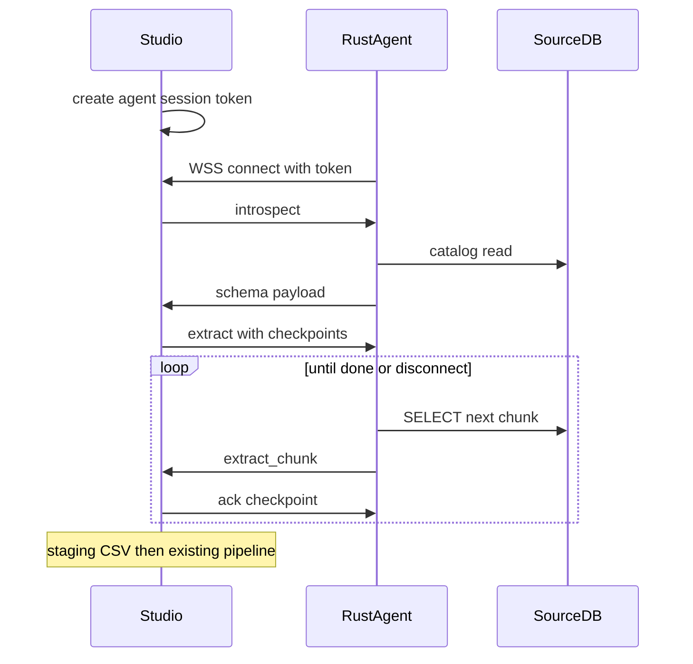

# hvyMETL 10.0 — Multi-engine Rust agent (WSS + full extract)

**Status:** shipped in **10.0.0**. Wave A engines, outbound secured WebSocket, schema plus scalable restartable full-table extract.

## Goal

The customer runs one downloaded Rust binary on a machine that can reach the source database. That agent:

1. Opens an **outbound** secured WebSocket to the studio.
2. Introspects **schema** for Wave A engines.
3. Streams a **full table extract** that is **scalable and restartable** (chunked, checkpointed, resumable after disconnect).
4. Never sends the DB connection string to the studio (URI stays on the client).

## Wave A engines (in binary)

| Engine | URI / path | Driver | Notes |
| --- | --- | --- | --- |
| MongoDB | `mongodb://`, `mongodb+srv://` | `mongodb` | Schema from sample; extract resumes on `_id` |
| PostgreSQL | `postgresql://` | `tokio-postgres` | Also wire-compatible Cockroach / Yugabyte / Aurora PG / Redshift |
| MySQL | `mysql://` | `mysql_async` | Also MariaDB / Aurora MySQL / SingleStore when protocol works |
| Microsoft SQL Server | `mssql://` / `sqlserver://` | `tiberius` | Encrypt/TLS defaults for Azure SQL |
| SQLite | file path or `sqlite://` | `rusqlite` | Local file on the agent host |

**Out of 10.0 (Wave B+):** Oracle, Db2, SAP ASE, ClickHouse, Snowflake, BigQuery, Spanner, Databricks, DynamoDB, HANA, Teradata, Firebird — DDL paste until a later major.

## Security model

- **Outbound only:** agent dials `wss://{studio}/api/agent/v2?token=…` (TLS). No listener on the customer network.
- **Token:** short-lived session from `POST /api/schema/agent-session` with sliding expiry during extract.
- **No URI on the wire:** connection string stays in agent CLI args / env; schema comments reject `://`.
- **Payload hygiene:** driver errors are scrubbed before send.
- **Size limits:** max frame size, max rows per chunk, max concurrent extract jobs per token.

## WebSocket protocol (v1)

JSON text frames.

**Agent → studio:** `hello`, `schema`, `extract_chunk`, `error`, `bye`, `pong`

**Studio → agent:** `welcome`, `introspect`, `extract`, `ack`, `cancel`, `ping`

**Checkpoint:** opaque per-table cursor (SQL PK tuple, MongoDB `_id`, SQLite `rowid`/PK). Studio acks each chunk; reconnect resumes after last ack. At-least-once delivery; staging is idempotent by `(jobId, table, checkpoint)`.

Tables without a usable primary key fail extract with a clear error (no silent `OFFSET` resume).

## Data landing path

1. Chunks land in a per-session staging directory as CSV.
2. Completed jobs attach staging as the pipeline CSV source.
3. Hosted studio refuses server-side live DB reads; agent extract is the hosted data path.

## Phases

| Phase | Deliverable |
| --- | --- |
| 0 | This roadmap + RELEASE planned note |
| 1 | WSS `/api/agent/v2` + MongoDB schema over WebSocket (HTTP poll kept) |
| 2 | Wave A schema introspect in Rust + studio live flags |
| 3 | Extract protocol + PostgreSQL full extract + resume |
| 4 | MySQL, MSSQL, SQLite, MongoDB extract drivers |
| 5 | Staging → pipeline, progress/cancel/TTL, operator notes |
| 6 | WSS default cutover, deprecate HTTP poll for new agents, ship **10.0.0** |

## Operator notes

- Open outbound **443** (or studio port) from the agent host to the studio; the DB stays on the LAN.
- **Azure SQL:** prefer `mssql://…?encrypt=true` (agent enables encryption by default for `mssql`/`sqlserver` URIs).
- **SQLite:** quote paths with spaces; `sqlite:///absolute/path.db` or a bare file path.
- Firewall must allow the agent host → database host (not studio → database).

## Non-goals

- Oracle / cloud warehouse drivers in the binary
- Bidirectional sync or CDC
- Agent listening for inbound studio connections
- Changing `SqlStructuralModel` IR shape

## Code map

| Area | Location |
| --- | --- |
| Session + HTTP poll (legacy) | [`src/server/liveAgent.ts`](../src/server/liveAgent.ts) |
| WSS + extract staging | [`src/server/liveAgentWs.ts`](../src/server/liveAgentWs.ts) |
| Rust agent | [`agent/`](../agent/) |
| Studio form / copy command | [`web/src/components/LiveMongoImportForm.tsx`](../web/src/components/LiveMongoImportForm.tsx) |
