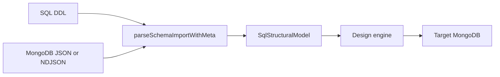

# hvyMETL 6.0 — MongoDB JSON input

JSON documents enter the same path SQL already uses. [`SqlStructuralModel`](src/types.ts) stays the intermediate representation. The design engine, After diagram, and pipeline stay callers of that model. A new parser sits beside the existing DDL, JSON Schema, and DynamoDB parsers in [`parseSchemaImportWithMeta`](src/utilities/schemaImport.ts).

## What already exists

- Dialect list and auto-detect already accept non-SQL paste: [`src/dialects.ts`](src/dialects.ts), [`src/utilities/detectDialect.ts`](src/utilities/detectDialect.ts).
- JSON Schema documents are not MongoDB data. [`parseJsonSchemaToModel`](src/utilities/jsonSchemaParser.ts) turns a schema into tables and promotes nested objects to child tables. Document JSON (`$oid`, `$date`, arrays of documents) does not go through that parser.
- The studio already pastes and uploads schema text in [`SchemaImportPanel`](web/src/components/SchemaImportPanel.tsx) and posts it to `POST /api/schema/import-ddl`.
- Load today is shaped CSV via csvToAtlas. JSON rows do not have that path.

## Phase 1 — Extended JSON parser

New module `src/utilities/mongoExtendedJson.ts`. Use the installed `mongodb` driver's `EJSON.parse` for Canonical and Relaxed Extended JSON. Do not hand-roll `$oid` / `$date` / `$numberLong` / `$numberDecimal`.

- JSON array: parse one document at a time from the array without holding a second copy of the file.
- NDJSON: read line by line. A line that is not one JSON object is a malformed record.
- Map types onto existing `ColumnModel.bsonType` strings: `objectId`, `date`, `long`, `decimal`, `int`, `double`, `bool`, `string`, `object`, `array`. `$numberDecimal` stays a decimal, not a double.

## Phase 2 — Infer the existing IR

New `parseMongoJsonToModel` in `src/utilities/mongoJsonParser.ts`, called from `parseSchemaImportWithMeta` when the dialect is `mongodb-json` or the paste is clearly documents (array of objects, NDJSON, or a single object with `$oid` / `$date`). Register the dialect next to `json-schema` in [`src/dialects.ts`](src/dialects.ts) and [`detectDialect`](src/utilities/detectDialect.ts).

Inference rules, matching how JSON Schema already becomes tables:

- One collection name from the file name, or `documents` for a paste. That is one `TableModel`.
- `_id` is the primary key when present.
- Nested objects and arrays of objects become child tables and relationships, the same shape `jsonSchemaParser` uses, so the design engine can embed them and the After diagram can show them.
- If the same path has two BSON types across documents, keep the field, set `bsonType` to `mixed`, and record the observed types on the column. The import result lists those conflicts. Do not drop the field and do not invent a second type system.
- Stream NDJSON. Infer from documents as they are read, with a hard cap on how many documents are held for conflict stats. The returned model carries `rowCount`. The original file path is what a later load reads again.

`ColumnModel` gains an optional `observedBsonTypes: string[]` only for conflicts. No new top-level IR.

## Phase 3 — Studio input

Stay on the current import panel. Add **MongoDB JSON** to the dialect selector. Paste and the existing file input both call `importDdl`.

- Validate as the user types: first non-empty line must be a JSON value, and Extended JSON wrappers that `EJSON.parse` rejects surface under the field. Keep the current textarea. Monaco is a later editor swap, not part of this release; the panel already pastes and uploads.
- After import, the existing schema tree and After diagram render the inferred model. Rename, drop, and type edits stay on the model the studio already edits before design.

## Phase 4 — Load

When the source dialect is `mongodb-json` and a file path is set, the pipeline reads that NDJSON or JSON array and bulk-writes with the existing Mongo driver (`insertMany`, unordered), after applying the plan's field renames and drops. It does not convert those documents to CSV.

- Default is lenient: a malformed line or a document that fails collection validation is counted on the pipeline execution error list and the rest continue.
- Strict mode stops the batch on the first such document. One boolean on the existing pipeline request. No new dead-letter collection.

SQL sources keep csvToAtlas.

## Release

Ship as **6.0.0** when the four phases land: `package.json`, a new top section in `RELEASE.md`, and the README release link. One focused test per phase: Extended JSON types, heterogeneous field merge, import route dialect, and a bulk write that records one bad line without failing the good documents.

## Left out

A second mapping engine, a new IR, Monaco, and rewriting SQL load. Large-file benchmarks wait until the stream parser and bulk writer exist.
